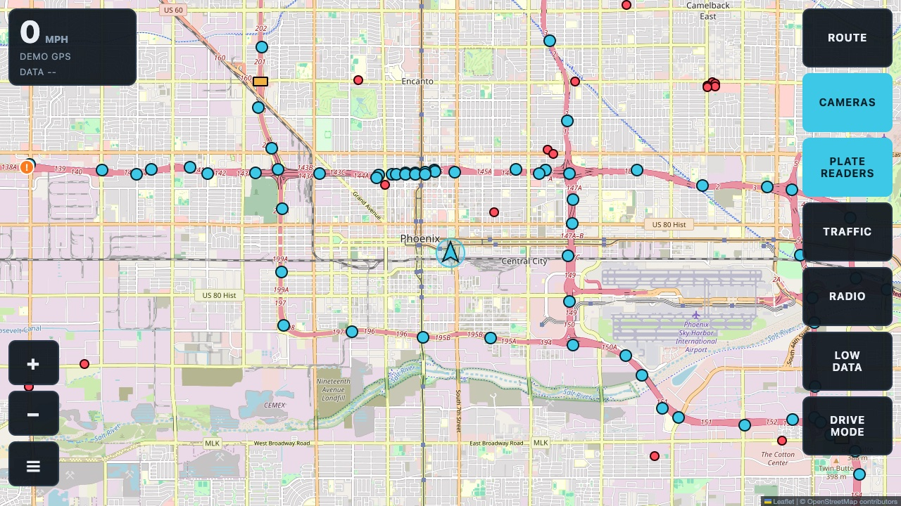
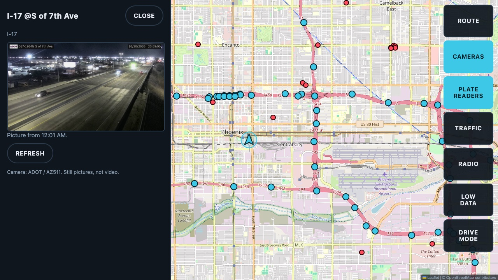
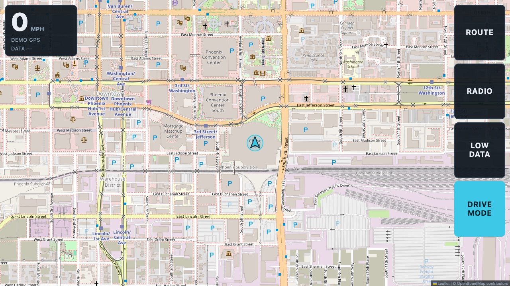

# GEV Road

**A lightweight 2D road map for Android car head units: Arizona traffic cameras, road closures, plate-reader locations, live police and fire radio, and spoken alerts, all hands-free while you drive.**

[](LICENSE)




GEV Road runs on a low-end Android 9 head unit (2 GB RAM, MediaTek MT8163,
1280x720, WebView 66). It keeps the road-focused parts of
[God's Eye View](https://github.com/bilawalsidhu/gods-eye-view) (MIT) and
drops the 3D globe, which is too heavy for the unit. It is a Leaflet page
inside a small Android WebView shell.

| Camera picture | Drive mode |
|---|---|
|  |  |

## Contents

- [Features](#features)
- [Getting started](#getting-started)
- [Keys](#keys)
- [Install from a USB stick](#install-from-a-usb-stick)
- [Data sources](#data-sources-all-checked-live-on-2026-10-06)
- [Plate-reader detector (optional)](#plate-reader-detector-optional-usb-add-on)
- [Engine data (optional)](#engine-data-optional-androbd-add-on)
- [Disclaimer](#disclaimer)
- [License and credits](#license)

## Features

- **Follow my truck:** the map stays centered on the truck's GPS, arrow points the way you drive. Drag the map to look around, tap RECENTER to come back.
- **Directions:** search a place or press and hold the map, then follow the turn bar. Re-routes when you leave the line.
- **Arizona cameras:** 644 ADOT highway cameras with your AZ511 key (604 on the keyless list). Tap one for a still picture, moving or stopped (off in low data mode).
- **Road info pop-ups (AZ511 key):** closures, crashes, overhead highway sign messages, road weather stations and rest areas. A card slides in by itself as you get close on your side of the road, so nothing needs a tap while driving; only active closures, crashes and high wind speak. Closures follow their weekly schedule, so a "Fri 9 PM to Mon 5 AM" closure stays quiet on a Monday.
- **Plate readers:** license plate reader locations mapped by OpenStreetMap volunteers.
- **Traffic:** live congestion colors (needs a free TomTom key).
- **Low data:** turns off traffic and camera pictures and stops the map zooming past street level, to save the hotspot. A banner suggests it after 100 MB.
- **Drive mode:** four big buttons, big speed, map locked to the truck.
- **Spoken alerts:** "Plate reader ahead", "You're in view of the I 10 at Tunnel camera", "Speed camera ahead, 40 miles per hour", "Red light camera ahead", hotspot data over 100 MB, off route, GPS lost or back, hotspot lost or back. Each has its own switch under ☰ → VOICE, ALERTS AND AI CHECK. Same-name ADOT cameras along a stretch speak once.
- **AI voice:** with an OpenAI key, pick one of 13 voices and 30 accents (Arabic, Chinese, Indian, British and more). Clips are cached, so a repeated alert costs nothing. Alerts already heard play from the cache even offline; a new one without internet (or without the key) uses the unit's own text-to-speech voice (needs "Speech Services by Google" or another engine on the unit). A clip is about the size of one map tile, so low data mode keeps the AI voice.
- **AI truck check:** stopped for 3 seconds within 300 m of an ADOT camera, the app sends that camera's picture to Gemini with your truck photo and description. ADOT posts a new picture about every 30 seconds, so when Gemini does not see the truck on a picture taken before you stopped, the app fetches the camera's next picture the moment it is up and asks once more (usually 15 to 25 seconds after the stop). Once per camera every 15 minutes. If your truck looks to be in it, it says so and shows the picture with the truck boxed. Free on Gemini's free tier (Google may use what is sent to improve its products); about a third of a MB each; off in low data mode. It is an AI guess: trucks look alike.
- **Plate-reader detector (optional USB board):** a flock-you board on the head unit's USB listens for Flock cameras' radios. GEV Road drops an orange diamond where the truck was when a camera was loudest and says "Plate reader camera detected". See [Plate-reader detector](#plate-reader-detector-optional-usb-add-on).
- **Engine data (optional, with AndrOBD):** coolant temperature and battery voltage under the speed, orange at 230°F, and "Engine running hot" out loud. See [Engine data](#engine-data-optional-androbd-add-on).
- **Radio:** police, fire and highway patrol while you drive, three ways:
  - *Live calls, played here:* Phoenix Police precinct dispatch, Phoenix Fire, DPS freeways, Chandler, Avondale and Sky Harbor, played inside the app from the Broadcastify Calls API (needs the prepaid keys below plus your Broadcastify login, typed once into the app).
  - *Live public safety feeds:* 24 Broadcastify and OpenMHz feeds for Phoenix and Tucson, nearest first, live only (delayed feeds are left out). Each opens that site's own page in a drawer over the map (their terms do not allow pulling the audio into another app); press play on their page, fold the drawer with HIDE and the audio keeps going.
  - *Every feed in this county:* one button opens Broadcastify's full list for the county the truck is in (police, fire, ham repeaters, GMRS, rail, weather, with who is online). The county comes from the FCC census lookup, or the nearest county center when offline.
  - *Radio stations near me:* Arizona internet radio stations from the public-domain Radio Browser directory, nearest first, played right in the page.
  - *My scanner:* an MP3 stream from your own receiver (RTL-SDR plus trunk-recorder, SDRTrunk or OP25), played right in the page.

## Getting started

Needs Node 24, JDK 17 and the Android SDK (platform 36, build-tools 36).

```bash
git clone https://github.com/landont987/gev-road.git
cd gev-road
npm install
npm test
cp keys.local.example.json keys.local.json   # then fill in the keys you have
npm run dev                                   # browser preview with a demo drive
```

`npm run dev` serves the page at http://localhost:4180 with a demo drive
around downtown Phoenix. Voice, GPS, USB and AndrOBD only exist on Android.

Build the APK:

```bash
node scripts/build-web.mjs --android
cd android && ./gradlew assembleRelease
```

The APK lands in `android/app/build/outputs/apk/release/app-release.apk`.

## Keys

Copy `keys.local.example.json` to `keys.local.json` (git-ignored, never
committed) and fill in the slots you need. Every key is optional; a feature
without its key stays off and says so.

| Slot | What it turns on | Where to get it |
|---|---|---|
| `az511` | Fresh camera list and road info pop-ups | Free AZ511 developer key |
| `tomtom` | Live traffic colors | Free TomTom developer key |
| `bcfyKeyId`, `bcfySecret`, `bcfyAppId` | Live calls played in the app | Broadcastify Developer Program, [bcfy.io/dev](https://bcfy.io/dev) (prepaid) |
| `bcfyUser`, `bcfyPass` | Live-calls sign-in built in (optional) | Your Broadcastify account |
| `openai` | AI voice for spoken alerts | OpenAI API key (pay per use) |
| `gemini` | AI truck check at cameras | Free key from [Google AI Studio](https://aistudio.google.com) |
| `truckDescription` | What the AI truck check looks for | Year, make, model, color and what stands out |

> [!WARNING]
> `scripts/build-web.mjs` builds the keys into the app. Keep your APK to
> yourself: never commit it, attach it to a release or share it.

For the AI truck check, also save a photo of your truck as `truck.local.jpg`
(about 1200 px wide and 100 KB, since every check uploads it; never
committed). Keys are built into the APK, so keep the APK to yourself and set a
monthly spending limit on the OpenAI account. The Gemini free tier has a daily
limit; past it the check pauses until the limit resets.

Without `az511` the camera list is the AZGeo copy (last
edited 2026-03-16). With `bcfyUser` and `bcfyPass` the live-calls login is built into the app, so
nothing is typed on the head unit; leave them out and the unit asks once and
remembers. Without the three `bcfy` id/secret/app values the LIVE CALLS section only
shows a note. The Calls API endpoints and token format are copied from working
open source clients; the first run with a real key is the proof.

## Install from a USB stick

1. Copy the APK to a FAT32 USB stick.
2. On the head unit, open the file manager, open the USB drive, tap the APK.
3. If Android blocks it, allow "Install unknown apps" for the file manager when it asks.
4. Open GEV Road and allow location.
5. For speed: in the Play Store, update "Android System WebView" and, if it is
   installed, "Google Chrome" (on Android 9 either one can be what draws the
   app). Reopen GEV Road; ☰ → VERSION shows the WebView number. 66 is from
   2018; 138 is the newest Android 9 can get (Chrome 139 needs Android 10).

## Data sources (all checked live on 2026-10-06)

| What | Source | Key |
|---|---|---|
| Map | OpenStreetMap standard tiles, shown as they come (no darkening filter, to keep the head unit fast) | none (OSMF tile policy: light use, app identifies itself) |
| Cameras | ADOT list via AZGeo `ADOT_cameras` FeatureServer; pictures from `az511.com/map/Cctv/<id>` | none |
| Plate readers | `tiles.dontgetflocked.com` hourly OSM extract (DeFlock) | none |
| Directions | OSRM at `routing.openstreetmap.de` (FOSSGIS) | none |
| Search | Photon at `photon.komoot.io` | none |
| Traffic | TomTom flow tiles | free key, not yet verified |
| Cameras (fresh list) | AZ511 API `api/v2/get/cameras` | free AZ511 developer key, 10 calls a minute |
| Road info | AZ511 API `event`, `messagesigns`, `weatherstations`, `restareas` (no CORS header, so the Android app fetches them; the closures list is about 2.4 MB, 280 KB gzipped) | same AZ511 key |
| Live calls | Broadcastify Calls Client API `api.bcfy.io` | app key id, secret and app id from bcfy.io/dev (prepaid, from $5) plus a Broadcastify login |
| Public feeds | Broadcastify feed pages and OpenMHz system pages, opened as-is | none |
| County feed list | Broadcastify county pages, opened as-is; county from `geo.fcc.gov/api/census/area` | none |
| Radio stations | Radio Browser `de1.api.radio-browser.info` (PDDL directory); streams straight from each broadcaster | none |
| Speed and red-light cameras | OpenStreetMap via Overpass (`node["highway"="speed_camera"]` in Arizona), bundled in `web/src/data/az-speed-cameras.json` (26 cameras, 2026-10-07) and refreshed daily when Overpass answers | none |
| AI voice | OpenAI `gpt-4o-mini-tts` at `api.openai.com/v1/audio/speech` | OpenAI API key (pay per use) |
| Plate-reader detector | your own flock-you board on USB (firmware by colonelpanichacks, MIT); GEV Road only reads its output | none |
| Engine data | the AndrOBD app (fr3ts0n, GPL-3.0) as a separate app, through its plugin intents | none |
| AI truck check | Gemini API, `gemini-3.5-flash-lite`, at `generativelanguage.googleapis.com/v1beta/models/...:generateContent` | free Gemini key from Google AI Studio (free tier) |

Not used, and why: CARTO dark tiles now need a key. AZ511's `/list/getdata/`
and `/map/map*/` paths are blocked by its robots.txt, so camera lists come from
the state's AZGeo copy (and later the official AZ511 API with a key).

**Data licenses and terms.** OpenStreetMap data, including the bundled
`web/src/data/az-speed-cameras.json` and the DeFlock plate-reader tiles, is ©
OpenStreetMap contributors under the
[Open Database License (ODbL)](https://www.openstreetmap.org/copyright). The
Radio Browser directory is public domain (PDDL). Camera pictures and road
information belong to ADOT / AZ511, traffic tiles to TomTom, and feeds to
Broadcastify and OpenMHz, each under its own terms. GEV Road never relays or
embeds Broadcastify web-feed audio: live calls use your own Calls API keys, and
web feeds open on Broadcastify's own page. If you run your own copy, bring your
own keys and follow each provider's terms.

## Plate-reader detector (optional USB add-on)

A Seeed XIAO ESP32-S3 board ($7.49) running
[flock-you](https://github.com/colonelpanichacks/flock-you) (MIT) listens for
Flock plate-reader cameras' Wi-Fi and Bluetooth signals and prints one line per
hit over USB. It only listens and never connects to a camera; connecting to one
would be unauthorized access. GEV Road contains none of its code: the Android app
reads the board's USB serial output (Detector.java) and the page turns each line
into a pin and a spoken alert (web/src/detector*.js).

**Will it detect anything?** Not guaranteed. Flock changed its cameras around
December 2025 and again in September 2026; on 2026-09-16 the flock-you author
said Wi-Fi/Bluetooth detection "may be quickly coming to an end", then released
new signatures from a camera firmware dump on 2026-09-17 with "no guarantees"
(flock-you issue #61). Reflash the board when flock-you updates.

Setup:
1. Flash the board from a computer with [PlatformIO](https://platformio.org/):
   in a flock-you checkout, `pio run -e xiao_esp32s3 -t upload`.
2. Plug it into the head unit's USB. A USB extension run to the glovebox or
   console keeps it reachable (and makes app installs easier).
3. Parked: ☰ → PLATE-READER DETECTOR → CONNECT, then allow GEV Road.
4. Optional, once you have watched it work: turn on OPEN GEV ROAD WHEN THE BOARD
   IS PLUGGED IN. Android then stops asking at each start ("use by default"), and
   it opens GEV Road by itself whenever the board appears.

What it does with a hit: strong hits (the camera's probe-request fingerprint,
flock-you tiers 3 and 4) pin and speak; weak hits (a radio maker or battery pack
match, tier 2) only pin unless WEAKER HITS is on; echoes (tiers 0 and 1) are
ignored. One camera speaks once, and again only after the truck has been away
from it for 5 minutes and 10 have passed, so parking next to one stays quiet.
Pins (up to 300) stay on the unit and show with PLATE READERS.

Test without a board: `npm run test:java` (the line splitter) and the debug
build's injector, which feeds the same path a board's bytes take:
`adb shell am broadcast -a com.landon.gevroad.DEBUG_DETECTOR_LINES --es b64 "$(base64 < test/fixtures/flockyou-serial.txt)"`.

## Engine data (optional AndrOBD add-on)

[AndrOBD](https://github.com/fr3ts0n/AndrOBD) (GPL-3.0, free on F-Droid) runs as
its own app on the head unit and reads an OBD-II adapter (plan: a WiCAN on the
phone hotspot). GEV Road registers as an AndrOBD plugin with plain Android intents
(AndrobdPlugin.java answers its plugin search; EngineDataService.java receives
`engine_coolant_temperature` and `ecu_voltage`). It contains none of AndrOBD's code
or its GPL plugin library.

1. Install AndrOBD, then open GEV Road once so AndrOBD can find it.
2. AndrOBD → menu → Plugin manager: GEV Road listed and on.
3. Connect AndrOBD to the adapter and open OBD Data. Readings show under the speed.

Test without a truck: AndrOBD's Adapter type DEMO makes up readings that jump
around the whole range, above 230°F too. Without AndrOBD, the same messages can be sent from a computer:
`adb shell am startservice -n com.landon.gevroad/.EngineDataService -a com.fr3ts0n.androbd.plugin.DATA --es com.fr3ts0n.androbd.plugin.extra.DATA engine_coolant_temperature=111.0`.
`adb logcat -s GevEngine` shows when GEV Road answers AndrOBD's plugin search.

Readings arrive while GEV Road or AndrOBD is on screen (Android 9's background
rules). Coolant shows only once AndrOBD has named its units (°C or °F, in its data
list), and each coolant reading waits 5 s, because AndrOBD sends a °F number just
before it says "°F". AndrOBD's Freeze frame screen sends its stored readings like
live ones, so GEV Road may show them. Never tap "Clear fault codes" in AndrOBD
before an emissions test: it resets the readiness checks.

## Disclaimer

GEV Road is an independent personal project. It is not affiliated with or
endorsed by ADOT, AZ511, Broadcastify, OpenMHz, Flock Safety, DeFlock, TomTom,
OpenAI or Google. Map data, camera locations and road information can be late,
incomplete or wrong, and the AI features are guesses. Keep your eyes on the
road: the app is built so nothing needs a tap while driving. Obey traffic laws,
and check your local laws on radio scanners and electronics in vehicles.

## License

[MIT](LICENSE). GEV Road builds on
[God's Eye View](https://github.com/bilawalsidhu/gods-eye-view) by Bilawal
Sidhu (MIT); its notice is kept in [THIRD_PARTY_NOTICES.md](THIRD_PARTY_NOTICES.md). Data stays under its
own license (see [Data sources](#data-sources-all-checked-live-on-2026-10-06)).

## Credits

Map data © OpenStreetMap contributors. Cameras: ADOT / AZ511. Plate reader
locations: OpenStreetMap volunteers via DeFlock. Routing: OSRM / FOSSGIS.
Search: Photon by komoot. Traffic: TomTom. Radio: Broadcastify and OpenMHz
volunteer feeds, Broadcastify Calls. Map library: Leaflet.
Plate-reader detector: flock-you by colonelpanichacks (MIT); detection research by
@NitekryDPaul and DeFlockJoplin. Engine data: AndrOBD by fr3ts0n (GPL-3.0), a separate app.
Data source choices from God's Eye View by Bilawal Sidhu (MIT).
